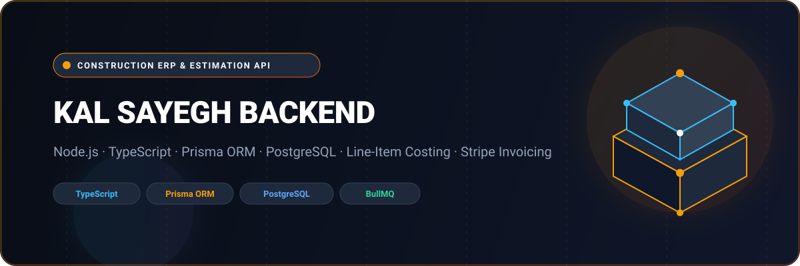

# 🏗️ Kal Sayegh — Construction ERP, Project Estimation & Billing Engine



<p align="center">
  <a href="https://www.postman.com/shahjalal-backend-9458759/shahjalal-api-portfolio/collection/48491387-76caf980-4e3e-4a2f-85af-487412849546" target="_blank">
    
  </a>
  <a href="https://www.postman.com/shahjalal-backend-9458759/shahjalal-api-portfolio/collection/48491387-76caf980-4e3e-4a2f-85af-487412849546" target="_blank">
    
  </a>
</p>

<p align="center">
  
  
  
  
  
  
  
  
</p>

---

## 📌 Executive Overview

**Kal Sayegh Backend** is an enterprise operations and financial calculation engine engineered for general construction contractors, commercial developers, and project estimators. Built on **Node.js, TypeScript, Express, and Prisma ORM**, the platform powers complex commercial construction workflows: itemized **line-item cost estimation**, automated **subcontractor markup & tax computing**, client proposal generation, **digital contract signing**, and milestone-based **invoice billing with Stripe**.

---

## 🚀 Key Architectural & Domain Capabilities

- **Construction Estimation Engine**: Granular project cost calculations incorporating unit costs, labor rates, equipment rental, profit markups, and municipal tax rules.
- **Contract & Proposal Workflows**: Generates formalized client proposals with terms, deposit milestones, and binding electronic sign-off tracking.
- **Milestone Invoicing & Stripe Integration**: Seamlessly converts approved project estimates into progress invoices, deposit payment captures, and automated payment receipts.
- **Master Item & Material Catalog**: Centralized database of construction items, material specifications, standard labor rates, and unit pricing.
- **Contractor & Estimator Role-Based Access (RBAC)**: Strict authorization separating General Contractors, Senior Estimators, Site Supervisors, and Clients.
- **Real-Time Project Coordination**: Socket-powered messaging and notifications for on-site engineers, project estimators, and clients.
- **Asynchronous Background Processing**: BullMQ job queues handling automated email estimate dispatches and invoice PDF generation.

---

## 📬 API Documentation & Interactive Postman Collection

The complete REST API specification is published in our public Postman showcase workspace:

* 🌐 **Instant Live API Documentation**: [Explore Kal Sayegh in Postman (Instant Web View)](https://www.postman.com/shahjalal-backend-9458759/shahjalal-api-portfolio/collection/48491387-76caf980-4e3e-4a2f-85af-487412849546)
* 📁 **Local Postman File**: [`docs/postman_collection.json`](./docs/postman_collection.json) (ready for Postman Desktop or Newman CI runs).

### Core Endpoint Modules

| Module | Base Route | Key Capabilities |
|---|---|---|
| **Authentication & Users** | `/api/v1/auth`, `/api/v1/user` | Multi-role contractor onboarding, JWT session management, RBAC guards |
| **Estimates** | `/api/v1/estimate` | Create, calculate line items, apply markups, generate client proposals |
| **Invoices & Billing** | `/api/v1/invoice` | Milestone billing, deposit receipts, balance tracking, PDF generation |
| **Contracts** | `/api/v1/contract` | Author proposals, bind terms, record client signature status |
| **Item Catalog** | `/api/v1/item` | Construction materials, equipment, and labor cost master records |
| **Markups & Taxes** | `/api/v1/markup`, `/api/v1/tax` | Configurable profit margins, overhead percentages, and tax rates |
| **Clients** | `/api/v1/client` | Commercial client profiles, project histories, contact directories |
| **Schedules & Visits** | `/api/v1/schedule` | Site inspection appointments and project calendar coordination |
| **Collaboration** | `/api/v1/room`, `/api/v1/message` | Contractor-client messaging rooms and notification feeds |

---

## 📂 Project Architecture

```plaintext
kalsayegh_backend/
├── assets/
│   └── banner.svg               # Architectural visual banner
├── docs/
│   └── postman_collection.json  # Full Postman API collection v2.1
├── src/
│   ├── app/
│   │   ├── middlewares/         # Global error handling, auth & validation guards
│   │   ├── modules/             # Domain modules (Estimate, Invoice, Contract, Item, Markup)
│   │   │   ├── estimate/        # Estimation calculator & proposal service
│   │   │   ├── invoice/         # Billing & deposit collection service
│   │   │   ├── contract/        # Contract terms & client sign-off
│   │   │   ├── item/            # Material & unit cost catalog
│   │   │   └── client/          # Client management
│   │   └── routes/              # Centralized route registration
│   ├── config/                  # Environment, Stripe & database configs
│   └── server.ts                # Application bootstrapper
├── prisma/
│   └── schema.prisma            # Prisma schema (PostgreSQL)
├── .env.example                 # Sanitized environment template
├── package.json
└── tsconfig.json
```

---

## 🛠️ Quickstart & Local Setup

### Prerequisites
* **Node.js**: `v20.x` or higher
* **Database**: PostgreSQL
* **Redis**: Required for BullMQ job queues

### 1. Clone & Install Dependencies
```bash
git clone https://github.com/shahjalal-labs/kalsayegh_backend.git
cd kalsayegh_backend
npm install
```

### 2. Configure Environment
```bash
cp .env.example .env
```

### 3. Initialize Prisma & Run Migrations
```bash
npx prisma generate
npx prisma db push
```

### 4. Run Development Server
```bash
npm run dev
```

---

## 👨‍💻 Engineering & Authorship

Developed and maintained by **Md. Shahjalal**.

* **GitHub**: [@shahjalal-labs](https://github.com/shahjalal-labs)
* **Email**: [muhommodshahjalal@gmail.com](mailto:muhommodshahjalal@gmail.com)

---

## 📄 License

This project is licensed under the [ISC License](LICENSE).
